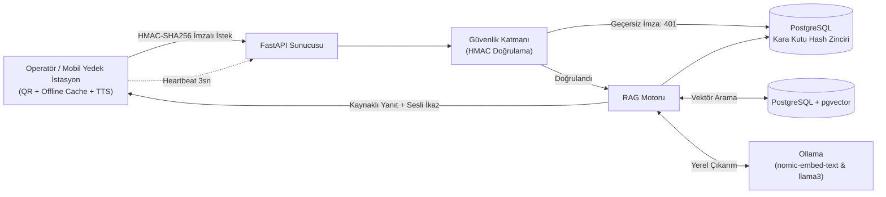

# 🛡️ Air-Gapped İHA Teknik Bakım ve Acil Durum Karar Destek Sistemi

İnternet erişiminin kapalı olduğu (*air-gapped*) savunma sanayii ve saha operasyonlarında, İHA operatörlerinin acil durum anlarında yüzlerce sayfalık teknik bakım kılavuzlarında arama yaparken yaşadığı zaman kaybını sıfırlamak için geliştirilmiş, halüsinasyon korumalı yerel RAG (*Retrieval-Augmented Generation*) tabanlı karar destek istasyonu.

## 🎯 Temel Özellikler

1. **HMAC-SHA256 Komut Güvenliği:** Yerel ağ (*LAN*) üzerinden gelen tüm sorgular operatör kimliği ve zaman damgasıyla kriptografik olarak imzalanır; yetkisiz istekler ve *replay* saldırıları reddedilir.
2. **Heartbeat Protokolü ve Yedeklilik (*Failover*):** İstemci arayüzü yerel sunucuyu düzenli sinyallerle izler. Bağlantı koptuğunda sistem otomatik olarak cihaz içi çevrimdışı acil durum moduna geçer.
3. **Değiştirilemez Kara Kutu Günlüğü (*Black-Box Audit Log*):** Doğrulanmış tüm sorgular ve reddedilen yetkisiz erişim denemeleri, bir önceki kaydın SHA-256 özetine zincirlenerek PostgreSQL veritabanına kaydedilir.
4. **QR Kod ile Mobil Yedek İstasyon ve Çevrimdışı Önbellek:** Ana yer kontrol istasyonu ekranı devre dışı kaldığında operatör mobil cihazıyla QR kodu okutarak yerel ağdan sisteme bağlanır; kritik arıza prosedürleri tarayıcı önbelleğinde hazır tutulur.
5. **Sesli İkaz Sistemi (*TTS*):** Acil müdahale adımları operatörün gözünü uçuş verilerinden ayırmaması için sesli olarak okunur.

## 🏗️ Sistem Mimarisi



## 🛠️ Teknoloji Yığını

* **Backend:** Python, FastAPI, Uvicorn
* **Yapay Zeka (Yerel / Kapalı Devre):** Ollama (`llama3`, `nomic-embed-text`)
* **Veritabanı & Vektör Arama:** Docker, PostgreSQL 16, `pgvector`
* **Güvenlik & Saha Arayüzü:** HMAC-SHA256, SHA-256 Hash Chain, QRCode, Web Speech API (TTS), `localStorage` Failover

## 🚀 Kurulum ve Çalıştırma

1. Ortam dosyasını oluşturun:
```bash
cp .env.example .env
```
2. `pgvector` veritabanını başlatın:
```bash
docker compose up -d
```
3. Python bağımlılıklarını kurun ve sunucuyu başlatın:
```bash
python3 -m venv venv
source venv/bin/activate
pip install -r requirements.txt
uvicorn app.main:app --host 0.0.0.0 --port 8000 --reload
```
4. Tarayıcıdan `http://localhost:8000` adresini açın.

## 🗺️ Geliştirme Yol Haritası (v2)

- [ ] Canlı Taktik Harita ve Otonom Geofence Sınır İhlali Simülasyonu
- [ ] Hibrit Arama (PostgreSQL `tsvector` BM25 + `pgvector` RRF Sıralama)
- [ ] Deterministik Sayısal Halüsinasyon Doğrulayıcı (*Numeric Verifier*)
- [ ] Kara Kutu Hash Zinciri Bütünlük Denetim Ucu (`/api/logs/verify`)
- [ ] Çoklu Yerel Model Kıyaslama Paketi (*RAG Benchmark*)
